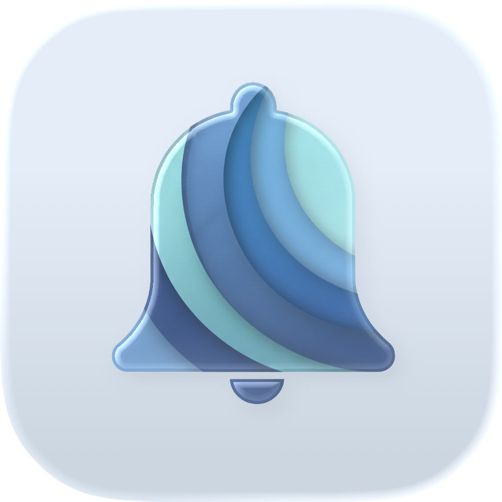

<p align="center">
  
</p>

<h1 align="center">ntfy+</h1>

<p align="center">
  Die iPhone-App für <a href="https://ntfy.sh">ntfy</a> — Benachrichtigungen vom eigenen<br>
  oder öffentlichen ntfy-Server empfangen und selbst welche senden.
</p>

<p align="center">
  
  
  
  
  
</p>

## Worum es geht

ntfy stellt Nachrichten, die ein Skript oder Server per HTTP an ein Topic
schickt, allen Geräten zu, die es abonniert haben. ntfy+ ist eine iPhone-App
dafür, mit eigenem Server oder ntfy.sh.

## Funktionen

- **Eigener Server oder ntfy.sh** — mehrere Server nebeneinander
- **Echtzeit** — neue Nachrichten über Server-Sent Events, Push auch bei geschlossener App
- **Geschützte Topics** — Benutzername/Passwort oder Access Token, auch für Push
- **Senden** — Nachrichten mit Titel, Priorität, Tags, Anhängen (Fotos und Dateien bis
  15 MB) und geplantem Zustellzeitpunkt
- **Anhänge und Icons** — Bildvorschau in der Mitteilung, Icons aus der Nachricht
  (etwa von Sonarr, Radarr oder Home Assistant)
- **Aktionen** — Knöpfe aus der Nachricht, HTTP-Aktionen mit Rückfrage vor dem Senden
- **Topics gestalten** — eigene Farben, Buchstaben oder Icons, stummschalten
- **Prioritäten** — dringende Nachrichten sichtbar hervorgehoben
- **Widget** — ungelesene Nachrichten auf dem Home-Bildschirm
- **App-Sperre** — Sperre und Sichtschutz, auf dem iPad für alle Fenster
- **Ohne Netz** — Nachrichten bleiben lokal gespeichert
- Hell und Dunkel, iPhone und iPad

## Installation

Die App ist noch nicht im App Store. Die aktuelle Fassung **2.2 (Build 8)** gibt
es über TestFlight; Zugang auf Anfrage über die Kontaktadresse unten.

Zum Loslegen braucht es iOS 27 oder neuer und einen ntfy-Server — ntfy.sh ist
voreingestellt, ein eigener funktioniert genauso.

**Erste Schritte:** App starten; die Einrichtung führt durch Server, optionale
Anmeldung und das erste Topic.

## Versionen

Was sich wann geändert hat, steht in [CHANGELOG.md](CHANGELOG.md). Die
[Releases](https://github.com/Revisor01/ntfy-plus-ios/releases) fassen jede
Version zusammen.

## Selbst bauen

```bash
git clone https://github.com/Revisor01/ntfy-plus-ios.git
cd ntfy-plus-ios
open ntfy-ios.xcodeproj
```

Xcode 27 oder neuer, Ziel ist iOS 27. Die Swift-Pakete lädt Xcode beim ersten
Öffnen selbst (Stand in `Package.resolved`). In den Signierungs-Einstellungen
das eigene Team eintragen. Für Push bei geschlossener App braucht es ein
eigenes Firebase-Projekt mit `GoogleService-Info.plist`; ohne kommen
Nachrichten nur, solange die App läuft.

## Aufbau

```
ntfy-plus-ios
├── ntfy/                         — die App: Views, Models (SwiftData), Services
│                                   (ntfy-API, SSE, Push, Schlüsselbund)
├── NotificationServiceExtension/ — lädt Inhalte geschützter Topics und Bild-
│                                   anhänge, bevor die Mitteilung erscheint
└── NtfyWidget/                   — Widget für den Home-Bildschirm
```

**Worauf es beim Bauen ankommt:**
- **Zugangsdaten gehören in den Schlüsselbund**, nie in die Einstellungen.
- **Keine Zugangsdaten an fremde Hosts** — angemeldet wird nur beim eigenen Server.
- **Verhalten wie upstream ntfy**, wo das Protokoll es vorgibt (Markdown, Aktionen,
  Anhänge).

## Mitmachen

Fehlermeldungen und Vorschläge sind willkommen — gern als
[Issue](https://github.com/Revisor01/ntfy-plus-ios/issues); die Vorlage fragt
nach App- und Server-Version. Sicherheitslücken bitte vertraulich melden, wie in
[SECURITY.md](SECURITY.md) beschrieben. Pull Requests laufen durch einen Build
und einen Secret-Scan; siehe
[CONTRIBUTING.md](CONTRIBUTING.md).

## Datenschutz

ntfy+ sammelt nichts für den Entwickler: keine Analyse, keine Werbung.
Server-Adressen, Zugangsdaten (im Schlüsselbund), Topics, Nachrichten und
Einstellungen liegen auf dem Gerät und verschwinden mit der App.

Die App spricht mit den ntfy-Servern, die man selbst einträgt. Für
Push-Mitteilungen bei geschlossener App meldet sie sich bei Apple (APNs) und
Google Firebase Cloud Messaging an und abonniert dort die Namen der Topics;
der ntfy-Server stellt Push-Nachrichten über diesen Weg zu.

## Lizenz

ntfy+ steht unter der
[GNU Affero General Public License v3.0](LICENSE). Wer ntfy+ verändert und
anderen zur Verfügung stellt, auch als Webdienst, legt seinen Quelltext unter
derselben Lizenz offen. Für
Beiträge gilt [CONTRIBUTING.md](CONTRIBUTING.md).

Die Fassungen im App Store verteilt der Urheber als Rechteinhaber selbst.

## Hinweis

ntfy+ ist eine unabhängige App. Sie ist kein offizielles Produkt des
ntfy-Projekts und wird von ihm weder unterstützt noch geprüft.

Dank an [ntfy](https://ntfy.sh) von Philipp C. Heckel — den großartigen
Open-Source-Dienst, ohne den es diese App nicht gäbe.

## Kontakt

Pastor Simon Luthe · [mail@simonluthe.de](mailto:mail@simonluthe.de) ·
[simonluthe.de](https://simonluthe.de)
